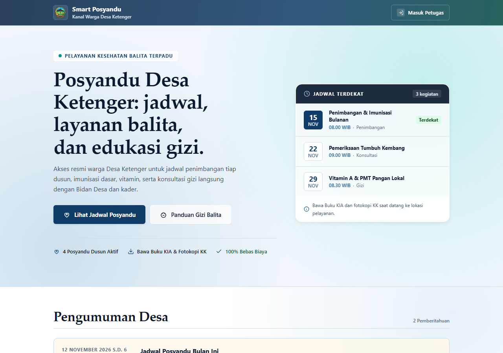
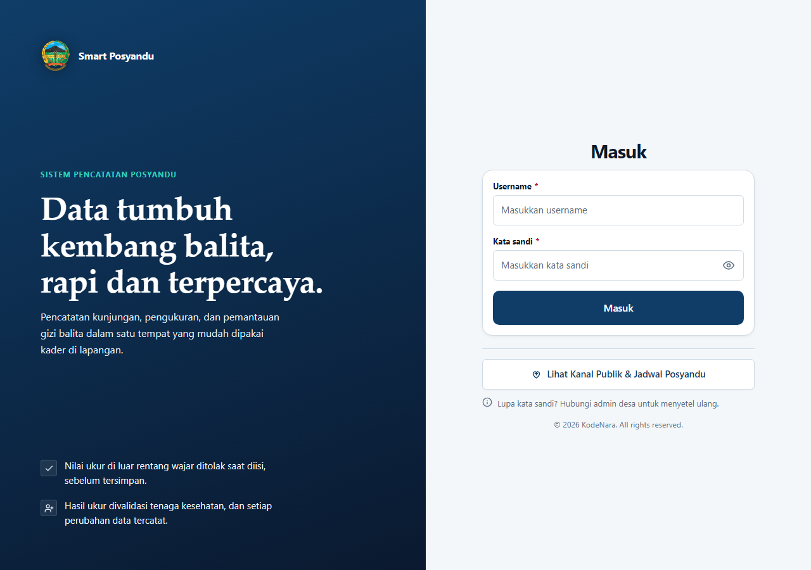
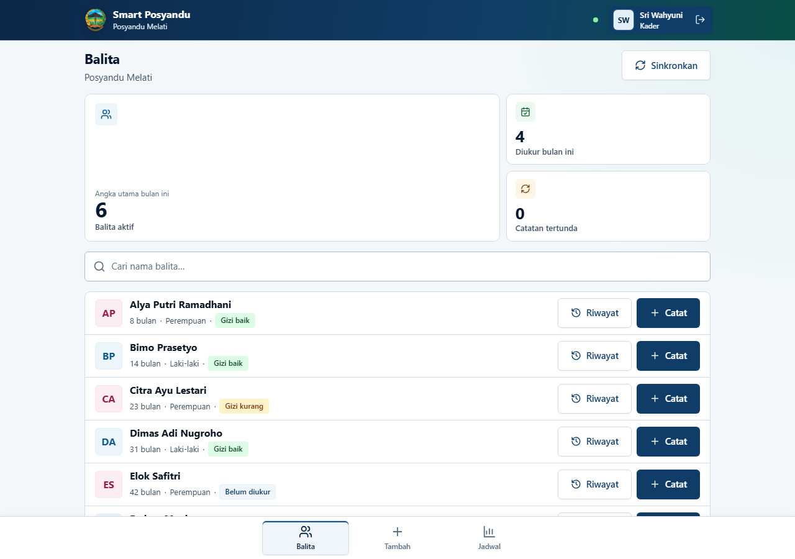
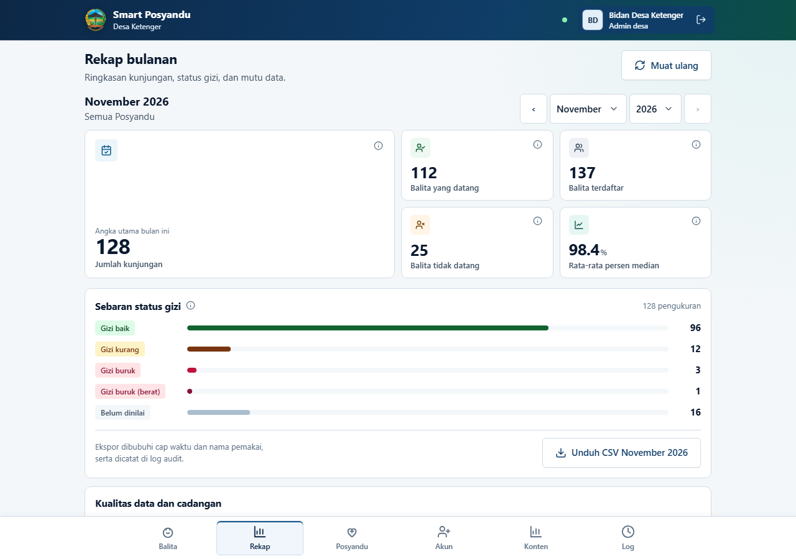

# Smart Posyandu

Aplikasi web PWA (*Progressive Web App*) untuk pencatatan posyandu dan pemantauan tumbuh kembang balita. Dirancang agar kader posyandu tetap bisa mencatat data saat tidak ada sinyal (luring) dan otomatis tersinkronkan saat tersambung internet.

---

## Tangkapan Layar

Data pada gambar berikut adalah **data contoh**, bukan data warga.



**Kanal publik** — jadwal, layanan, dan pengumuman yang bisa dibuka warga tanpa login.



**Masuk petugas** — akses kader, nakes, dan admin desa.



**Beranda kader** — daftar balita, indikator yang sudah diukur, dan status gizi terakhir.



**Rekap admin** — ringkasan kunjungan bulanan, sebaran status gizi, dan ekspor CSV.

---

## Fitur Aplikasi

Fitur disesuaikan dengan peran pengguna:

### 1. Kader Posyandu
- **Daftar & Pencarian Balita:** Menampilkan data balita per posyandu dengan status gizi terkini dan indikator balita yang sudah/belum diukur bulan ini.
- **Pencatatan Kunjungan & Pengukuran:** Input berat badan, tinggi badan, lingkar kepala, cara ukur (terlentang/berdiri), status kehadiran, serta catatan khusus. Mendukung penyimpanan draf otomatis.
- **Pendaftaran Balita Baru:** Mendaftarkan balita dan data wali/orang tua secara langsung dari tablet kader saat di lapangan.
- **Grafik Tumbuh Kembang & Riwayat:** Melihat kurva pertumbuhan berat/umur (KMS) berbasis Chart.js dan riwayat kunjungan bulanan balita.
- **Mode Luring & Sinkronisasi Otomatis:** Pencatatan tetap berjalan tanpa jaringan internet; data otomatis terkirim begitu kembali online dengan indikator antrean sinkronisasi.

### 2. Petugas Kesehatan / Bidan (Nakes)
- **Validasi Pengukuran:** Peninjauan hasil pengukuran kader sebelum disahkan atau ditindaklanjuti.
- **Pemberian Tindak Lanjut:** Catatan rujukan atau intervensi untuk balita dengan status gizi berisiko (kurang/gizi buruk/stunting).

### 3. Admin Desa
- **Kelola Data Balita:** Tambah, perbarui, dan nonaktifkan data master balita se-desa.
- **Laporan & Rekap Bulanan:** Rekapitulasi cakupan posyandu, sebaran status gizi balita, dan ekspor data ke CSV.
- **Manajemen Akun:** Pengelolaan akun pengguna (kader, nakes, admin) dan penugasan ke posyandu masing-masing.
- **Pencadangan & Pemulihan Basis Data:** Unduh cadangan berkala, pulihkan data, dan pantau status cadangan langsung dari antarmuka.
- **Kelola Konten Kanal Publik:** Menulis jadwal, informasi layanan, pengumuman desa, dan materi edukasi yang tayang ke warga.

### 4. Kanal Publik (tanpa login)
- **Jadwal Posyandu:** Jadwal terdekat per dusun, hanya yang sudah disetujui petugas kesehatan.
- **Pengumuman & Layanan:** Pemberitahuan resmi desa dan daftar layanan yang tersedia.
- **Edukasi & Pencegahan:** Materi gizi dan kesehatan, termasuk artikel tarikan dari KodeNara.

### 5. Fitur Umum & Keamanan
- **Log Aktivitas:** Catatan audit masuk, keluar, percobaan gagal, dan perubahan data — hanya untuk admin desa.
- **Privasi Data:** Enkripsi NIK serta proteksi sesi berbasis cookie `HttpOnly` (`SameSite=Strict`).

---

## Tech Stack

- **Frontend:** React, Vite, Tailwind CSS v4, Chart.js, IndexedDB (Dexie/PWA)
- **Backend:** Node.js (>=20), Express.js
- **Database:** PostgreSQL (>=14)
- **Keamanan:** Argon2 (password hash), AES-GCM (enkripsi data sensitif), Helmet

---

## Setup & Menjalankan

### Kebutuhan
- Node.js versi 20+
- PostgreSQL versi 14+

### Langkah Cepat

1. **Pasang Dependensi**
   ```bash
   npm run siapkan
   ```

2. **Atur Environment**
   ```bash
   cp .env.contoh .env
   # Sesuaikan DATABASE_URL, KUNCI_RAHASIA, dan VITE_API
   ```

3. **Inisialisasi Database & Buat Admin**
   ```bash
   createdb posyandu
   npm run migrasi
   npm run buat-admin -- admin_desa "Nama Admin"
   ```

4. **Jalankan Aplikasi**
   ```bash
   npm run dev
   ```
   Akses di browser:
   - **Klien:** `http://127.0.0.1:5173`
   - **API:** `http://127.0.0.1:3000`

---

## Perintah Bantuan

```bash
npm run demo                    # Isi 3.000 balita + 16 konten kanal publik untuk pengujian
npm run demo:hapus              # Bersihkan data demo (konten buatan sendiri tetap utuh)
npm run uji                     # Jalankan unit test (klien & server)
npm run cadangan                # Buat file cadangan database
npm run konten:kodenara         # Tarik artikel tips KodeNara sekarang
npm run konten:kodenara:bersih  # Buang artikel hasil tarikan
```

---

## Dokumentasi Teknis

Panduan mendalam ada di folder `docs/`:
- `docs/PANDUAN-PEMAKAI.md` — Panduan alur operasional bagi kader dan admin.
- `docs/PANDUAN-PENGEMBANG.md` — Petunjuk pengembangan dan arsitektur kode.
- `docs/ARSITEKTUR.md` — Desain sistem, skema data, dan keamanan.
